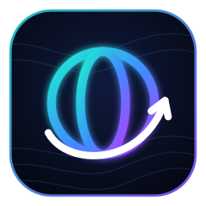
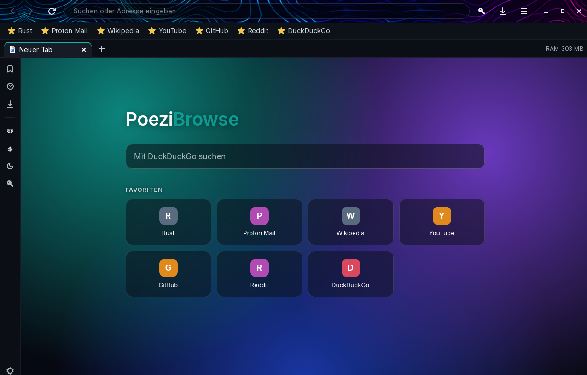
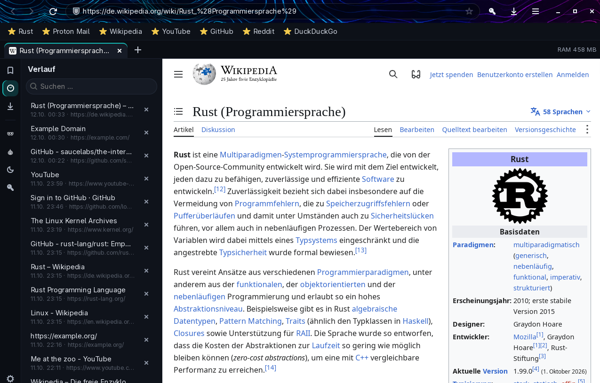
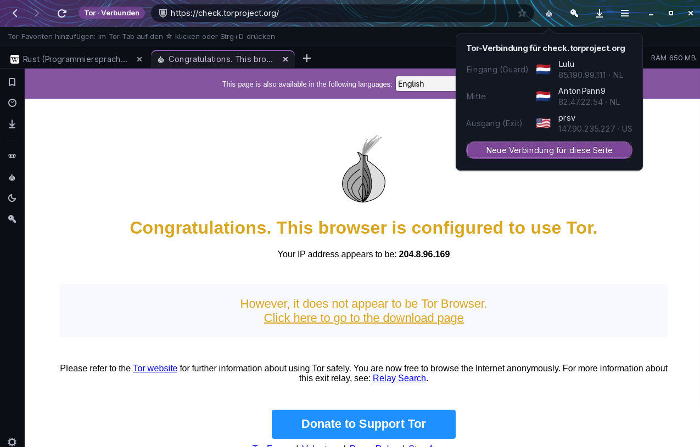

<p align="center">
  
</p>

<h1 align="center">PoeziBrowse</h1>

<p align="center">
  <b>Ein schlanker Webbrowser für Linux, geschrieben in Rust.</b><br>
  Schlafende Tabs, eingebauter Werbe- und Trackerblocker, private Tabs und Tor-Tabs, KeePassXC-Anbindung – und keine Telemetrie.
</p>

<p align="center">
  <a href="https://github.com/poezi123/poezibrowse/releases/latest"></a>
  <a href="https://github.com/poezi123/poezibrowse/releases"></a>
  
  <a href="LICENSE"></a>
</p>

<p align="center">
  <a href="#download">Download</a> ·
  <a href="#installation">Installation</a> ·
  <a href="#funktionen">Funktionen</a> ·
  <a href="#arbeitsspeicher">Arbeitsspeicher</a> ·
  <a href="#tastenkuerzel">Tastenkürzel</a> ·
  <a href="#faq">FAQ</a> ·
  <a href="README.md">English</a>
</p>

<p align="center">
  
</p>

---

## Was ist PoeziBrowse?

Moderne Browser werden mit jeder Version größer. PoeziBrowse geht den anderen Weg: eine kleine native
GTK-Oberfläche in Rust um die WebKit-Engine (die Engine von Safari und GNOME Web). Tabs, die du gerade
nicht nutzt, schlafen ein und geben ihren Speicher frei, Tabs teilen sich Prozesse, und Werbung und
Tracker werden geblockt, bevor sie überhaupt geladen werden. Kein Konto, kein Sync-Dienst, keine
Telemetrie, nichts läuft im Hintergrund.

## Download

<a id="download"></a>

| System | Paket | |
|---|---|---|
| **Arch Linux**, Garuda, CachyOS, Manjaro, EndeavourOS | `poezibrowse-0.4.0-1-x86_64.pkg.tar.zst` | [Download](https://github.com/poezi123/poezibrowse/releases/download/v0.4.0/poezibrowse-0.4.0-1-x86_64.pkg.tar.zst) |
| **Ubuntu 24.04+**, Debian 13, Linux Mint 22 | `poezibrowse_0.4.0_amd64.deb` | [Download](https://github.com/poezi123/poezibrowse/releases/download/v0.4.0/poezibrowse_0.4.0_amd64.deb) |
| **Jedes andere Linux** (Fedora, openSUSE, …) | `poezibrowse-0.4.0-linux-x64.tar.gz` | [Download](https://github.com/poezi123/poezibrowse/releases/download/v0.4.0/poezibrowse-0.4.0-linux-x64.tar.gz) |

Alle Versionen und Prüfsummen (`SHA256SUMS.txt`) stehen auf der
[Release-Seite](https://github.com/poezi123/poezibrowse/releases).

**Voraussetzungen:** Linux auf x86_64 mit glibc 2.39 oder neuer, GTK 3 und WebKitGTK 4.1 (ab 2.40) –
also Ubuntu 24.04, Debian 13, Fedora 40 oder jedes aktuelle Arch-basierte System.

## Installation

<a id="installation"></a>

**Arch Linux und Ableger**

```sh
sudo pacman -U poezibrowse-0.4.0-1-x86_64.pkg.tar.zst
```

**Ubuntu, Debian, Linux Mint** – Datei doppelklicken oder:

```sh
sudo apt install ./poezibrowse_0.4.0_amd64.deb
```

**Jede andere Distribution** – zuerst WebKitGTK 4.1 über die Paketverwaltung installieren, dann (ohne Root-Rechte):

```sh
tar xzf poezibrowse-0.4.0-linux-x64.tar.gz
cd poezibrowse-0.4.0-linux-x64
./install.sh        # trägt PoeziBrowse ins Startmenü ein (~/.local)
```

**Optional:** `tor` für Tor-Tabs, `keepassxc` zum Speichern von Logins in einer KeePassXC-Datenbank,
`gst-plugin-dav1d` (Arch) für schnelle AV1-Videos, `lyrebird` oder `snowflake-client` für Tor-Brücken.

**Download prüfen** (optional):

```sh
sha256sum -c SHA256SUMS.txt --ignore-missing
```

## Funktionen

<a id="funktionen"></a>

<p align="center">
  
</p>

**Surfen**
- Tabs mit Drag & Drop, das **+** direkt neben dem letzten Tab, Mausrad wechselt die Tabs
- Favoritenleiste, Favoriten auf der Startseite, umbenennen per Rechtsklick
- Seitenleiste mit Lesezeichen, Verlauf und Downloads
- Vorschläge in der Adressleiste aus Favoriten und Verlauf, Suche mit DuckDuckGo, Startpage, Brave, Ecosia, Qwant oder Google
- Sitzung wiederherstellen – wiederhergestellte Tabs laden erst, wenn du sie öffnest
- Zoom mit Strg + Mausrad, Zurück/Vor mit den Daumentasten der Maus, Suchen auf der Seite, Drucken, Entwicklerwerkzeuge
- Hintergründe für die Startseite: Vorlagen oder eigenes Bild, mit Abdunkeln und Unschärfe
- Fensterleiste mit dem wandernden Höhenlinien-Muster aus [PoeziCode](https://github.com/poezi123/poezicode), Bildrate einstellbar
- Hell, Dunkel oder wie das System

**Privatsphäre**
- Werbe- und Trackerblocker (EasyList, EasyPrivacy, EasyList Germany), direkt im Content-Blocker von WebKit, wöchentlich aktualisiert; pro Seite abschaltbar über das Schild in der Adressleiste
- YouTube-Werbung wird aus den Player-Daten entfernt und übersprungen, falls doch eine durchkommt
- Private Tabs: kein Verlauf, Cookies werden beim Schließen des letzten privaten Tabs gelöscht
- Keine Telemetrie, kein Browsername im User-Agent, kein DNS-Prefetching, Intelligent Tracking Prevention an

**Tor-Tabs**

<p align="center">
  
</p>

- Tor-Tab über die Zwiebel in der Seitenleiste oder <kbd>Strg</kbd>+<kbd>Umschalt</kbd>+<kbd>U</kbd>; PoeziBrowse startet seinen eigenen Tor-Prozess
- Brücken: obfs4, webtunnel, meek und Snowflake
- Der Zwiebel-Button zeigt die Verbindung der aktuellen Seite – Eingang, Mitte und Ausgang mit Land und IP – und holt auf Wunsch eine neue
- Namen werden über Tor aufgelöst; WebRTC und WebGL sind aus, die Zeitzone ist UTC
- Eigene Tor-Favoriten; gesucht wird über den Onion-Dienst von DuckDuckGo
- Links aus einem Tor-Tab bleiben in Tor-Tabs

PoeziBrowse versteckt deine IP-Adresse, aber der Tor Browser schützt deutlich besser gegen
Browser-Fingerprinting. Wenn deine Sicherheit davon abhängt, nimm den Tor Browser.

**Passwörter**
- Deine **KeePassXC-Datenbank** oder eine neue PoeziBrowse-Datenbank (ebenfalls `.kdbx`)
- Ausgefüllt wird nur nach Klick auf den Schlüssel, nur auf HTTPS-Seiten und nur auf der passenden Seite
- Fragt vor dem Speichern neuer oder geänderter Logins – und erst, wenn der Login geklappt hat; geschrieben wird von KeePassXC selbst
- Passwort-Generator von KeePassXC für Registrierungen
- Das Master-Passwort wird mit dem TPM-Chip deines PCs verschlüsselt (`systemd-creds`) und alle 7 Tage neu abgefragt – im Klartext wird es nie gespeichert
- Details: [docs/passwortmanager.md](docs/passwortmanager.md)

## Arbeitsspeicher

<a id="arbeitsspeicher"></a>

Gemessen auf demselben Rechner mit frischem Profil (anteiliger Speicher aller Prozesse):

| | speedtest.net |
|---|---|
| Firefox | 654–869 MB |
| **PoeziBrowse** | **ca. 480 MB** |

Den meisten Speicher brauchen die Webseiten selbst. PoeziBrowse spart, wo es geht:

- Hintergrund-Tabs schlafen nach 10 Minuten ein und geben ihren Speicher komplett frei
- RAM-Budget (Standard 1,5 GB): darüber schläft sofort der am längsten unbenutzte Tab ein
- Bis zu sechs Tabs teilen sich einen Web-Prozess
- WebKit gibt seine Caches frei, wenn PoeziBrowse im Hintergrund ist
- Filterlisten werden in einem kurzlebigen Hilfsprozess umgewandelt

## Tastenkürzel

<a id="tastenkuerzel"></a>

| Kürzel | Aktion |
|---|---|
| <kbd>Strg</kbd>+<kbd>T</kbd> / <kbd>Strg</kbd>+<kbd>W</kbd> | Neuer Tab / Tab schließen |
| <kbd>Strg</kbd>+<kbd>Umschalt</kbd>+<kbd>T</kbd> | Geschlossenen Tab wieder öffnen |
| <kbd>Strg</kbd>+<kbd>Umschalt</kbd>+<kbd>P</kbd> | Privater Tab |
| <kbd>Strg</kbd>+<kbd>Umschalt</kbd>+<kbd>U</kbd> | Tor-Tab |
| <kbd>Strg</kbd>+<kbd>L</kbd> | Adressleiste |
| <kbd>Strg</kbd>+<kbd>D</kbd> | Zu den Favoriten |
| <kbd>Strg</kbd>+<kbd>H</kbd> / <kbd>Strg</kbd>+<kbd>Umschalt</kbd>+<kbd>O</kbd> / <kbd>Strg</kbd>+<kbd>Umschalt</kbd>+<kbd>Y</kbd> | Verlauf / Lesezeichen / Downloads |
| <kbd>Strg</kbd>+<kbd>F</kbd> | Auf der Seite suchen |
| <kbd>Strg</kbd>+<kbd>Tab</kbd>, <kbd>Strg</kbd>+<kbd>1</kbd>…<kbd>9</kbd> | Tab wechseln |
| <kbd>Strg</kbd>+<kbd>Umschalt</kbd>+<kbd>Bild↑/↓</kbd> | Tab verschieben |
| <kbd>Strg</kbd>+<kbd>+</kbd> / <kbd>-</kbd> / <kbd>0</kbd> | Zoom |
| <kbd>F9</kbd> | Seitenleiste ein/aus |
| <kbd>F11</kbd> / <kbd>F12</kbd> | Vollbild / Entwicklerwerkzeuge |

## FAQ

<a id="faq"></a>

**Warum WebKit und keine selbst geschriebene Engine?**
Eine Engine, die das heutige Web kann, ist ein Projekt über viele Jahre mit Hunderten Leuten. WebKit
ist ausgereift, schnell und leichter als Chromium. [Servo](https://servo.org), die in Rust geschriebene
Browser-Engine, soll später als zweite Engine dazukommen – siehe das
[Issue](https://github.com/poezi123/poezibrowse/issues/1).

**Manche WebM-Videos spielen nicht.**
WebKitGTK 2.52 kann VP9-Videos, die direkt als WebM-Datei eingebunden sind, nicht abspielen – das
passiert auch im MiniBrowser von WebKit selbst. PoeziBrowse sagt Webseiten deshalb, dass VP9 nicht
verfügbar ist, und schaltet solche Videos auf die MP4-Fassung der Seite um, wenn es eine gibt. YouTube
ist nicht betroffen.

**Ist der Tor-Modus so sicher wie der Tor Browser?**
Nein. Er versteckt deine IP-Adresse und löst Namen über Tor auf, hat aber nicht den Schutz des Tor
Browsers gegen Fingerprinting.

**Wo liegen meine Daten?**
`~/.local/share/poezibrowse` (Verlauf, Favoriten, Sitzung, Webseiten-Daten) und
`~/.config/poezibrowse/config.toml` (Einstellungen). Beides ist nur für deinen Benutzer lesbar.

**Wie baue ich PoeziBrowse selbst?**

```sh
sudo pacman -S rust webkit2gtk-4.1 gtk3 sqlite      # Arch
cargo build --release
./target/release/poezibrowse
```

## Lizenz

<a id="lizenz"></a>

PoeziBrowse ist freie Software unter der [GNU General Public License v3.0 oder neuer](LICENSE).
